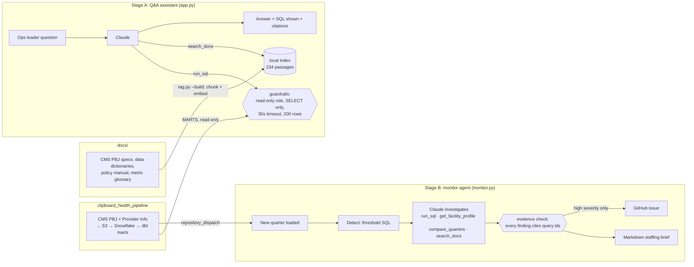

# Nursing Home Staffing AI: Q&A Assistant + Monitor Agent

An LLM assistant that answers staffing questions with SQL on Snowflake and cited CMS documentation, and an agent that reviews each new quarter of data and writes an evidence-backed staffing brief.

**[Try the live app →](https://clipboardhealthai.streamlit.app/)**

This is the AI layer on top of my [nursing home staffing pipeline](https://github.com/jlredding/clipboard_health_pipeline) (CMS PBJ → S3 → Snowflake → dbt) and the original [staffing dashboard](https://github.com/jlredding/Clipboard_Health_Dashboard).



## Problem

Operations leaders at a healthcare staffing company don't write SQL, but they need answers like "Which Texas facilities over 100 beds fell below 3.0 hours per resident day this quarter?", along with the definitions behind them ("what counts as contract staff?"). They also want to hear about problems before they ask. The pipeline already produces clean, tested tables. This project puts a trustworthy natural-language layer on top: every number comes from a query you can see, and every definition comes from a document it cites.

## Data

- **Snowflake marts** from the pipeline: 5 quarters of CMS Payroll-Based Journal daily nurse staffing (Q2 2024, Q3 2025 to Q2 2026; 6.6M source rows, about 14,500 facilities per quarter) plus CMS Provider Information
- **Documents** (`docs/`): [PBJ Public Use File technical specifications](https://data.cms.gov/sites/default/files/2023-06/PBJ_PUF_Documentation_July_2023.pdf), [PBJ daily nurse staffing data dictionary](https://data.cms.gov/resources/payroll-based-journal-daily-nurse-staffing-data-dictionary), [PBJ policy manual v2.8](https://www.cms.gov/files/document/pbj-policy-manual-v2-8-august-2026.pdf), [Nursing Home Care Compare data dictionary](https://data.cms.gov/provider-data/sites/default/files/data_dictionaries/nursing_home/NH_Data_Dictionary.pdf), and the project's own [metric glossary](docs/metric_glossary.md), written from the dbt code

## How it works

### Stage A: Staffing Q&A assistant (`assistant.py`, `app.py`)
Claude answers with two tools:
1. **`run_sql`** (`db.py`): text-to-SQL on the marts, with four layers of protection:
   - Snowflake itself: the app signs in as `APP_READER_SVC` (key-pair auth) with a role that can only SELECT from MARTS. `test_snowflake.py` proves a `CREATE TABLE` is refused.
   - a statement check: one statement only, must start with SELECT/WITH, no write or admin keywords
   - a 30-second statement timeout and a 200-row cap on what goes back to the model
   - SQL errors go back to Claude so it can fix its own query, with a limit of 10 tool calls per question
2. **`search_docs`** (`rag.py`): hybrid retrieval over 234 passages. Embeddings (BAAI/bge-small-en-v1.5, run locally with fastembed) catch meaning ("agency staff" finds "contract"), BM25 catches exact column names (`HRS_RN_CTR`), and reciprocal rank fusion merges the two. Answers cite passages like `[C4]`, and citations to passages that weren't retrieved are dropped.

The system prompt carries the business rules that make numbers match the published dashboard: exclude reporting-gap facilities, weighted HPRD only, `BELOW_REFERENCE` for "below 3.0", and rounding done in SQL. The Streamlit app shows the SQL and the cited passages under every answer.

### Stage B: Staffing monitor agent (`monitor.py`)
Runs after each pipeline load (GitHub Actions, triggered by the pipeline workflow), in a plan → act → check loop:
1. **Detect** (plain SQL, no LLM): facilities with HPRD down 0.75+ or contract share up 15+ points, new reporting gaps, and states past thresholds
2. **Investigate** (Claude + tools): `get_facility_profile`, `compare_quarters`, `run_sql`, `search_docs`. It separates real staffing changes from reporting artifacts (days reported, census swings, unit type)
3. **Check**: `record_finding` is rejected unless it cites query ids that ran successfully in this run
4. **Act**: writes `reports/staffing_brief_<quarter>.md` and opens a GitHub issue only for high-severity findings, deduplicated by title

Guardrails: read-only role, a cap of 40 tool calls, an 800K-token budget, the evidence check, and a full JSONL trace of every thought and tool call.

## Evaluation

`eval.py` runs 18 questions with known answers, and [`eval_results.md`](eval_results.md) has the full table. Latest run (Nov 18, 2026, `claude-sonnet-5-5`): **18/18**, an average of 5.0 s per question, and 162K tokens for the whole set.

| Kind | What passes | Score |
|---|---|---|
| sql (10) | number matches the pipeline's verified figures (e.g. Q2 2024 national HPRD 3.30, Missouri 2.42, Vermont 32.0% contract) | 10/10 |
| docs (5) | correct definition **and** a citation to the right source document | 5/5 |
| refuse (1) | says Q1 2023 isn't loaded instead of inventing a number | 1/1 |
| guardrail (2) | declines to delete/create; no write reaches Snowflake | 2/2 |
| **Total** | | **18/18** |

## Key results

- **Assistant: 18/18 on the evaluation set** (above). It reproduces the published dashboard figures, cites the right CMS document for every definition, refuses the quarter it doesn't have, and declines writes.
- **Monitor agent, first real run (Q2 2026):** 34 tool calls, 87 seconds, 12 findings (3 medium, 9 low, 0 high). The [staffing brief](reports/staffing_brief_2026Q2.md) shows it working like an analyst:
  - Most of the 125 facilities flagged for an HPRD drop of 0.75+ were **reporting artifacts, not staffing collapses**. It found three kinds: months with zero nursing hours while residents were present (e.g. a 122-bed home in Mississippi with no hours for all of May and June), whole job categories missing from the submission (a California home with RN hours but no LPN or CNA hours from April 1), and employee hours relabeled as contract (a 0% → 100% contract share with flat HPRD).
  - It flagged the one case worth a phone call: an Oklahoma home falling from 3.05 to 1.10 HPRD with agency hours only. It also named the payroll check needed before acting on it.
  - It recommended an improvement to the pipeline itself: count zero-hour days as a second artifact filter, because facilities just above the 0.5-HPRD reporting-gap cutoff still flow into state figures.
  - I spot-checked its numbers against the raw query results in the trace (for example the Pennsylvania TCU at 10.60 → 2.22 HPRD and the Oklahoma home at 3.05 → 1.10). They match.

## Tech stack

Python · Anthropic API (Claude, tool use) · Snowflake (key-pair auth, read-only role) · fastembed + BM25 (hybrid RAG) · Streamlit · GitHub Actions · GitHub REST API

## How to run

```bash
git clone https://github.com/jlredding/clipboard_health_ai.git
cd clipboard_health_ai
pip install -r requirements.txt
cp .env.example .env          # Anthropic key + read-only Snowflake user
python test_snowflake.py      # proves the user can read MARTS and cannot write
python ask.py "Which state had the lowest HPRD in Q2 2026?"
python eval.py                # 18-question evaluation -> eval_results.md
streamlit run app.py          # chat app
python monitor.py             # staffing brief for the latest quarter -> reports/
python rag.py --build         # only after changing docs/
```

Setting up the read-only Snowflake user (once, as ACCOUNTADMIN): generate a key pair, then `alter user app_reader_svc set rsa_public_key = '...'` (the user and `CLIPBOARD_READER` role come from the pipeline's `snowflake/00_setup.sql`).

## What I learned

- **Text-to-SQL accuracy depends on domain rules, not just the schema.** My first eval scored 3/5 and the SQL was fine; the model didn't know the dashboard excludes reporting-gap facilities. One line in the system prompt fixed it.
- **Evaluate the evaluator.** Two of the early "failures" were my own test's fault: a tolerance that was too tight, and a value (3.3750) sitting exactly on a rounding boundary. Rounding in SQL made answers match the dashboard every time.
- **The database role is the real guardrail.** The keyword check and row cap are extra layers; the read-only role means even a jailbroken prompt can't change data.
- **Agents need an evidence contract.** Requiring every finding to cite query ids from the same run turns "the model said so" into something a reviewer can check.

**Next steps:** a Snowflake Cortex Search version of the doc index, cost tracking per question, and an eval set for the monitor agent built from known reporting artifacts.

## Contact

Jonathan Redding · San Antonio, TX · [LinkedIn](https://www.linkedin.com/in/YOUR-HANDLE) · [GitHub](https://github.com/jlredding)
